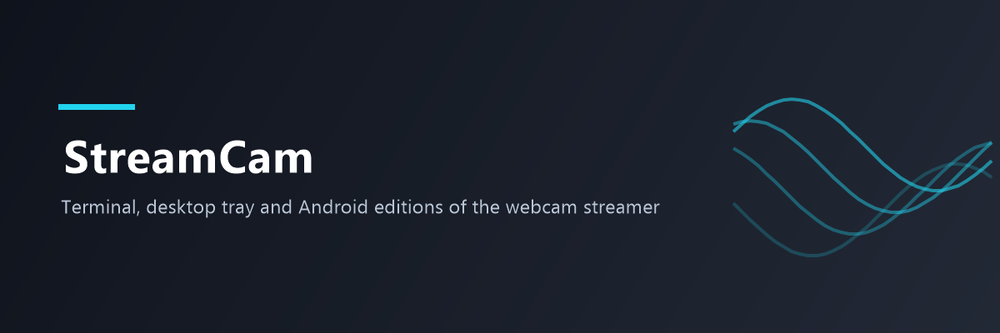

# StreamCam — App Edition



Turns the original terminal-based StreamCam into:

1. **`desktop/`** — a silent system tray app for your laptop. No terminal,
   optionally auto-starts at login.
2. **`mobile/`** — a Capacitor project that builds into a real Android
   `.apk` (and iOS `.ipa` on a Mac) — no browser needed on the phone.

## Quick start

```
desktop/   -> pip install -r requirements.txt && python tray_app.py
             (then `pyinstaller build.spec` once to get a double-click app)

mobile/    -> npm install && npx cap add android && npx cap open android
             (build the APK in Android Studio, install it on your phone)
```

Full details, including the "Start at Login" setup and the Android
manifest changes, are in `desktop/README.md` and `mobile/README_BUILD.md`.

## How it fits together

```
 ┌─────────────────────────┐        Wi-Fi        ┌──────────────────────┐
 │   Laptop tray app        │◄────────────────────►│   Phone app (APK)     │
 │   (desktop/tray_app.py)  │   MJPEG over HTTP    │   (mobile/www)        │
 │   - runs on login         │   :8080              │   - remembers your    │
 │   - no console window     │                       │     laptop's IP       │
 │   - camera + Flask server │                       │   - opens straight to │
 └─────────────────────────┘                       │     the live view     │
                                                     └──────────────────────┘
```

Nothing about the camera pipeline changed — `streamcam_core.py` is your
original `server.py` logic, just made importable/startable from the tray app
instead of run as `__main__`.
